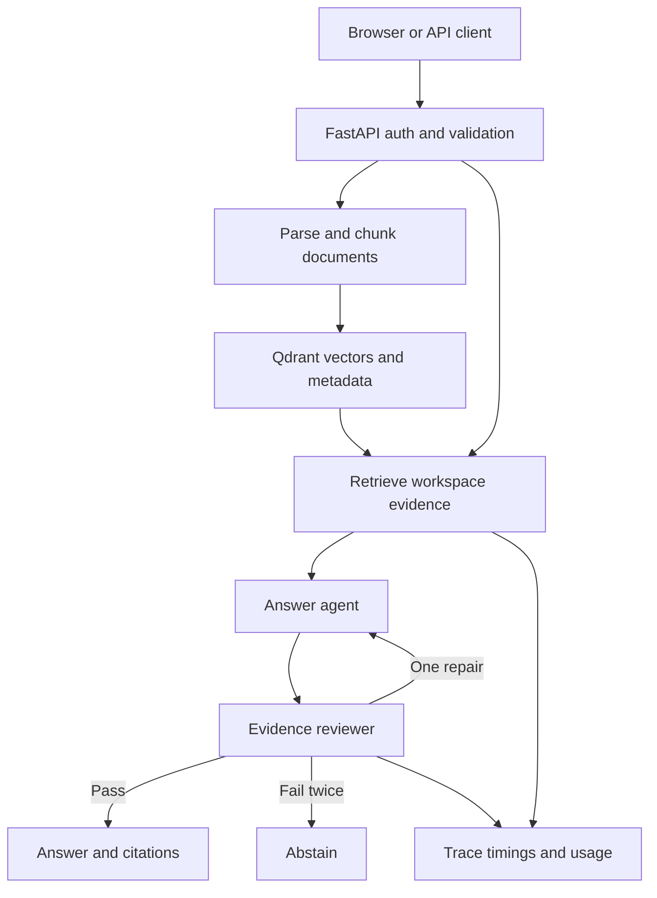

# FieldKit

An enterprise knowledge assistant prototype for Rohit Moradiya's engineering portfolio. Upload operational documents and CSV records, retrieve relevant evidence from Qdrant, and inspect answers, citations and workflow traces in a browser.

**Status:** implemented and locally tested offline. Gemini integration is implemented with mocked workflow tests, but no live provider call has been verified. Docker and Cloud Run assets are supplied, not deployed or container-tested. This is a portfolio prototype, not a production deployment or a claim of customer work.

## Run it on your laptop

Install Python 3.12, extract this project and open a terminal inside `fieldkit`.

```bash
python -m venv .venv
```

Windows PowerShell:

```powershell
.venv\Scripts\Activate.ps1
```

macOS/Linux:

```bash
source .venv/bin/activate
```

Then:

```bash
python -m pip install -r requirements-dev.txt
python scripts/start_demo.py
```

Open **http://127.0.0.1:8000**. The default local key is `local-demo-key`. Upload the three files in `samples/`, then ask:

- What is the response time for a P1 incident?
- What is the domestic hotel expense limit?
- Who owns the payments service?

Demo mode needs no API key or paid service. It uses hashed lexical vectors and exact source excerpts, not semantic embeddings or an LLM. It deliberately labels verification as `verbatim_only`.

API docs: **http://127.0.0.1:8000/docs**. Keep the default-key demo bound to localhost.

## Enable real AI

Stop the server. Set environment variables in the same terminal, then restart. The plain Python launcher does **not** automatically load `.env`; Docker Compose does.

PowerShell:

```powershell
$env:AI_MODE = "gemini"
$env:GEMINI_API_KEY = "YOUR_KEY"
python scripts/start_demo.py
```

macOS/Linux:

```bash
export AI_MODE=gemini
export GEMINI_API_KEY='YOUR_KEY'
python scripts/start_demo.py
```

Get a key from [Google AI Studio](https://aistudio.google.com/). Calls may incur provider charges. Configure `GEMINI_MODEL` and `EMBEDDING_MODEL` if the defaults are unavailable for your account. Re-upload the sample files after switching modes: demo and Gemini use separate Qdrant collections to avoid mixing incompatible vector spaces.

In Gemini mode, the app embeds documents and queries, runs an answer agent, then invokes a separate evidence-reviewer role. A failed review returns feedback to the answer agent for one repair attempt; a second failure abstains. The two roles use the same configured model in separate calls. This is a bounded agent workflow, not an autonomous ReAct agent or hierarchical multi-agent system.

## What you can demonstrate

| Requirement | Implementation | Verification status |
|---|---|---|
| Python engineering | FastAPI endpoints, validation, ingestion, tests | Local tests pass |
| Structured and unstructured data | CSV rows; TXT, Markdown and PDF text with row/page locators | Local tests pass |
| Vector database and retrieval | Qdrant local persistence, cosine search, workspace filters | Local tests pass |
| RAG | Gemini embedding, evidence-backed generation and citations | Integration code; live provider run pending |
| Agent framework | LangGraph conditional routing, answer/reviewer roles, bounded repair | Offline execution and mocked model tests pass |
| Tracing and LLM metrics | Per-node timings, request IDs, token usage, generation throughput and estimated cost | Local metrics and mocked usage tests pass |
| Secure API fundamentals | API-key-to-workspace mapping, isolated search/deletion/traces, limits | Local tests pass; not audited |
| Cloud architecture | Dockerfile, private Cloud Run deploy script, external Qdrant, secret injection | Configuration only; deployment pending |

## Architecture



The vector store persists indexed text; raw uploaded files are not retained. Gemini mode sends document chunks and questions to the provider. Each request has fresh graph state; there is no cross-request chat history or durable LangGraph checkpointing. Trace SQLite records retain metrics for seven days, pruned on subsequent requests. They exclude questions, answers and source passages. Structured metrics are also emitted to stdout for container logging.

## Test and evaluate

```bash
python -m pytest -q
python -m scripts.evaluate
```

`docs/evaluation_results.json` records the bundled synthetic smoke benchmark. It measures expected text/source matches and abstention on eight small cases, not general answer correctness. Latency varies by machine; do not advertise it as a production performance result. Tests include tenant isolation, input limits, authentication, idempotent ingestion, deletion, persistence, PDF/CSV parsing, provider failure handling, and reviewer repair/abstention.

## API examples

```bash
curl -H 'X-API-Key: local-demo-key' \
  -F 'file=@samples/incident_runbook.md' http://127.0.0.1:8000/api/documents
curl -H 'X-API-Key: local-demo-key' -H 'Content-Type: application/json' \
  -d '{"question":"What is the response time for a P1 incident?"}' \
  http://127.0.0.1:8000/api/query
```

| Method | Path | Purpose |
|---|---|---|
| POST | `/api/documents` | Upload and index a document |
| GET | `/api/documents` | List current workspace documents |
| DELETE | `/api/documents/{document_id}` | Remove only this workspace's document |
| POST | `/api/query` | Retrieve, draft, review and return evidence |
| GET | `/api/traces/{request_id}` | Fetch this workspace's trace |
| GET | `/health` | Process liveness and mode; not dependency readiness |

## Important design limits

- API keys are workspace-level credentials, not user identities. There is no SSO, per-document ACL or key-management UI.
- Local Qdrant requires a single process. Use external Qdrant before scaling. Concurrent requests share a lock for local database operations.
- Rate limiting is per-process and counts all authenticated endpoints. It is not a distributed quota system.
- Upload limits are enforced after multipart parsing. Use ingress body-size and timeout limits for untrusted public traffic; PDF extraction is not sandboxed.
- Ingestion is synchronous and bounded to small files; there is no background job queue, transactional cross-file ingest or automatic version replacement. A changed file creates a new document; remove the old one explicitly.
- The cosine threshold is a fixed heuristic. Calibrate it on your own evaluation set, separately for each embedding mode. CSV chunking is row-oriented; large table joins and aggregate questions require SQL tooling, not this RAG path.
- The LLM reviewer can be wrong and is not an independent factual authority. Document-based prompt injection is not solved by a system prompt. Keep human review for consequential answers.
- There is no streaming. `generation_tokens_per_sec` is total output tokens divided by total model-call duration across drafting and review; it is not time-to-first-token or streaming decode speed.
- Cost is unknown unless both input/output prices are configured. The estimate includes reported thinking tokens but excludes embedding, caching, infrastructure and other provider charges.
- Cloud Run's local SQLite trace history is ephemeral. JSON stdout traces can be retained by Cloud Logging; move the trace API to a durable store before multi-instance use.

Read [deployment instructions](docs/DEPLOYMENT.md), [interview notes](docs/INTERVIEW.md), and [resume wording](docs/RESUME_BULLETS.md) before presenting this project.

## Implementation references

- [LangGraph quickstart](https://docs.langchain.com/oss/python/langgraph/quickstart)
- [Google Gen AI Python SDK](https://googleapis.github.io/python-genai/)
- [Qdrant Python client](https://github.com/qdrant/qdrant-client)
- [Cloud Run deployment CLI](https://docs.cloud.google.com/sdk/gcloud/reference/run/deploy)

Built with AI assistance. Review, run and extend the code before presenting it as your engineering work. No employment, customer deployment, user count or business outcome is implied.
